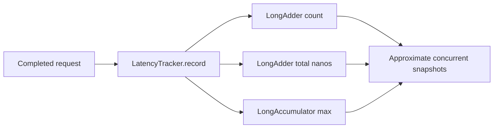

# Spring Boot Performance & Observability

Java 17 examples for interpreting latency and saturation signals.

## Run

```bash
mvn clean verify
```

## Implemented

- `LatencyTracker` aggregates request count, total elapsed nanoseconds, and maximum latency using concurrent accumulators.
- JUnit 5 checks empty values, concurrent recording, average and maximum latency.
- GitHub Actions Maven verification workflow.

## Data flow



`averageNanos()` uses separate concurrent snapshots and is **not** a consistent atomic snapshot while writes are in progress. This lightweight sample does not calculate p95/p99; production latency distributions require Micrometer timers/histograms.

## Metrics and local monitoring

Start the application with `mvn spring-boot:run`, then call `curl http://localhost:8080/work` and inspect `http://localhost:8080/actuator/prometheus`. The `demo_work_latency_seconds` histogram records demo work duration; `http_server_requests_seconds` covers incoming HTTP traffic. JVM memory, GC and thread metrics are exported through Actuator/Micrometer. For local Prometheus, use `monitoring/prometheus.yml`; `host.docker.internal` assumes Prometheus runs in Docker with access to the host. Adjust the scrape target for other environments.

The HTTP integration test requests `/work`, scrapes `/actuator/prometheus` and verifies both timer and HTTP metrics. Histograms support latency quantiles computed by Prometheus, e.g. `histogram_quantile(0.95, sum by (le) (rate(http_server_requests_seconds_bucket[5m])))`. Avoid high-cardinality metric labels such as raw user IDs or URLs.

## Troubleshooting playbook

Check request rate, error rate and p95/p99 latency together. Correlate rising latency with JVM GC pauses, heap usage, live threads, CPU saturation, downstream call latency and database connection-pool wait time. Averages can hide tail latency. This project does not yet instrument a real database or executor, so those signals require additional integrations.

Example alert ideas (tune thresholds against a real SLO): sustained 5xx rate, p95 latency above the agreed budget, high GC pause time, or sustained executor queue growth. Avoid alerting on isolated samples.

## Interview prompts

Why does a good average latency not rule out a poor p99? Which metrics distinguish JVM GC pauses from thread-pool or database saturation?
