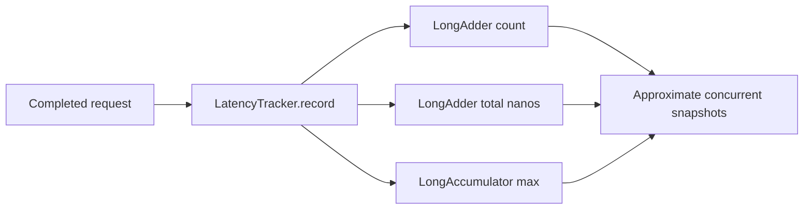

# Spring Boot Performance & Observability

Java 17 examples for interpreting latency and saturation signals.

## Run

```bash
mvn clean verify
```

## Implemented

- `LatencyTracker` aggregates request count, total elapsed nanoseconds, and maximum latency using concurrent accumulators.
- JUnit 5 checks empty values, concurrent recording, average and maximum latency.
- GitHub Actions Maven verification workflow.

## Data flow



`averageNanos()` uses separate concurrent snapshots and is **not** a consistent atomic snapshot while writes are in progress. This lightweight sample does not calculate p95/p99; production latency distributions require Micrometer timers/histograms.

## Metrics and local monitoring

Start the application with `mvn spring-boot:run`, then call `curl http://localhost:8080/work` and inspect `http://localhost:8080/actuator/prometheus`. The `demo_work_latency_seconds` histogram records demo work duration; `http_server_requests_seconds` covers incoming HTTP traffic. JVM memory, GC and thread metrics are exported through Actuator/Micrometer. For local Prometheus, use `monitoring/prometheus.yml`; `host.docker.internal` assumes Prometheus runs in Docker with access to the host. Adjust the scrape target for other environments.

The HTTP integration test requests `/work`, scrapes `/actuator/prometheus` and verifies both timer and HTTP metrics. Histograms support latency quantiles computed by Prometheus, e.g. `histogram_quantile(0.95, sum by (le) (rate(http_server_requests_seconds_bucket[5m])))`. Avoid high-cardinality metric labels such as raw user IDs or URLs.

## Troubleshooting playbook

Check request rate, error rate and p95/p99 latency together. Correlate rising latency with JVM GC pauses, heap usage, live threads, CPU saturation, downstream call latency and database connection-pool wait time. Averages can hide tail latency. This project does not yet instrument a real database or executor, so those signals require additional integrations.

Example alert ideas (tune thresholds against a real SLO): sustained 5xx rate, p95 latency above the agreed budget, high GC pause time, or sustained executor queue growth. Avoid alerting on isolated samples.

## Interview prompts

Why does a good average latency not rule out a poor p99? Which metrics distinguish JVM GC pauses from thread-pool or database saturation?


## Step-by-step local quickstart and verification

**Environment:** JDK **17**, Maven **3.9+**, Git, a terminal and internet access for Maven dependencies. Port **8080** must be free. Docker is **not required** to run the app or tests; Docker is optional if you want a standalone Prometheus server. No database or Kafka is used.

1. Clone and verify the toolchain:
   ```bash
   git clone https://github.com/rocky-bgta/spring-boot-performance-observability.git
   cd spring-boot-performance-observability
   java -version
   mvn -version
   ```
2. Run all tests, including the actual HTTP scrape integration test:
   ```bash
   mvn -B clean verify
   ```
   **Expected:** `BUILD SUCCESS`. The integration test enables observability with `@AutoConfigureObservability`, requests `/work`, then verifies the real `/actuator/prometheus` output includes both demo and HTTP metrics.
3. Start the application and leave it running:
   ```bash
   mvn spring-boot:run
   ```
4. In another terminal, generate sample requests:
   ```bash
   curl http://localhost:8080/work
   curl http://localhost:8080/work
   curl http://localhost:8080/actuator/health
   ```
   Expected: `/work` returns `ok`; health reports `UP`.
5. Open `http://localhost:8080/actuator/prometheus` in a browser or run:
   ```bash
   curl http://localhost:8080/actuator/prometheus
   ```
   Look for `demo_work_latency_seconds_count` and `http_server_requests_seconds_count`; after two `/work` calls, the demo timer count should be at least 2. The response also includes JVM/GC/process metrics. The endpoint exposes **Prometheus text**, not a visual dashboard. For an Actuator JSON view, open `http://localhost:8080/actuator/metrics`.
6. **Optional:** start Prometheus using Docker while Spring Boot is still running:
   ```bash
   docker run --rm --name demo-prometheus -p 9090:9090 -v "${PWD}/monitoring/prometheus.yml:/etc/prometheus/prometheus.yml:ro" prom/prometheus
   ```
   This bind-mount command is for bash-like shells; **PowerShell:** use `-v "${PWD}/monitoring/prometheus.yml:/etc/prometheus/prometheus.yml:ro"` with Docker Desktop. On Linux Docker Engine, `host.docker.internal` may require `--add-host=host.docker.internal:host-gateway`. Open `http://localhost:9090/targets` and verify the `spring-boot-observability` target is **UP**; inspect `demo_work_latency_seconds_count` in the Prometheus query UI. Prometheus is not required for `mvn verify`.
7. Stop Spring Boot (and optional Prometheus) with Ctrl+C. Maven test reports are in `target/surefire-reports/`; GitHub Actions runs `mvn -B verify` on Java 17.

**Troubleshooting:** A `404` on `/actuator/prometheus` means the endpoint is not exposed or its registry is unavailable; check `application.yml`, the Prometheus Micrometer dependency and the app startup logs. For Spring Boot tests, the `@AutoConfigureObservability` annotation is needed to enable metrics instrumentation in the test context. If port 8080 is occupied, pass `-Dspring-boot.run.arguments=--server.port=8081` to `mvn spring-boot:run` and update URLs accordingly. Windows PowerShell can use `curl.exe` to avoid its built-in alias.
