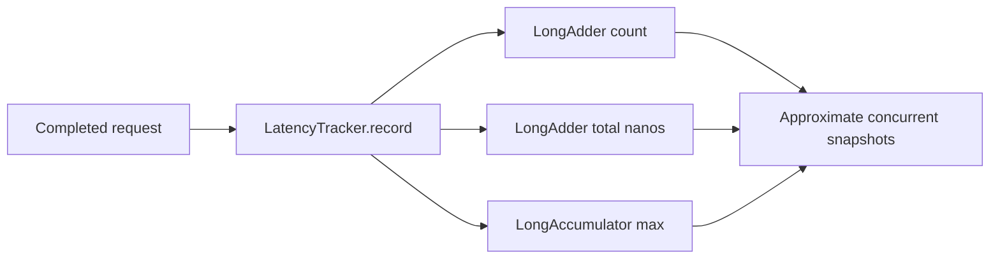

# Spring Boot Performance & Observability

Java 17 examples for interpreting latency and saturation signals.

## Run

```bash
mvn clean verify
```

## Implemented

- `LatencyTracker` aggregates request count, total elapsed nanoseconds, and maximum latency using concurrent accumulators.
- JUnit 5 checks empty values, concurrent recording, average and maximum latency.
- GitHub Actions Maven verification workflow.

## Data flow



`averageNanos()` uses separate concurrent snapshots and is **not** a consistent atomic snapshot while writes are in progress. This lightweight sample does not calculate p95/p99; production latency distributions require Micrometer timers/histograms.

## Next implementation milestones

- Spring Boot Actuator, Micrometer HTTP/JVM/thread-pool metrics.
- Prometheus scrape endpoint, example dashboard and alert thresholds.
- Reproducible saturation/load tests and database latency troubleshooting.

## Interview prompts

Why does a good average latency not rule out a poor p99? Which metrics distinguish JVM GC pauses from thread-pool or database saturation?
